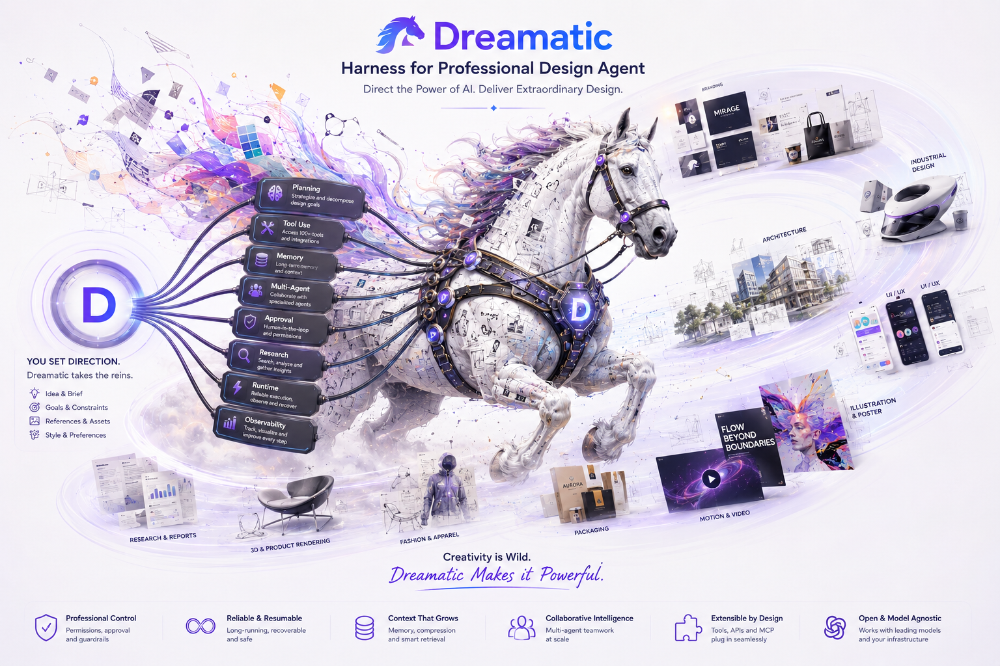
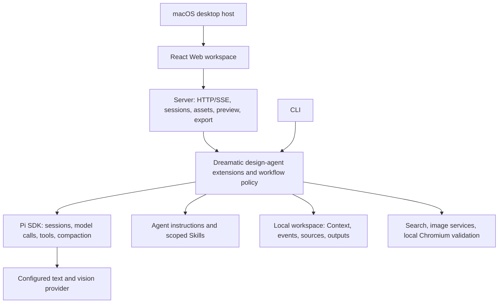
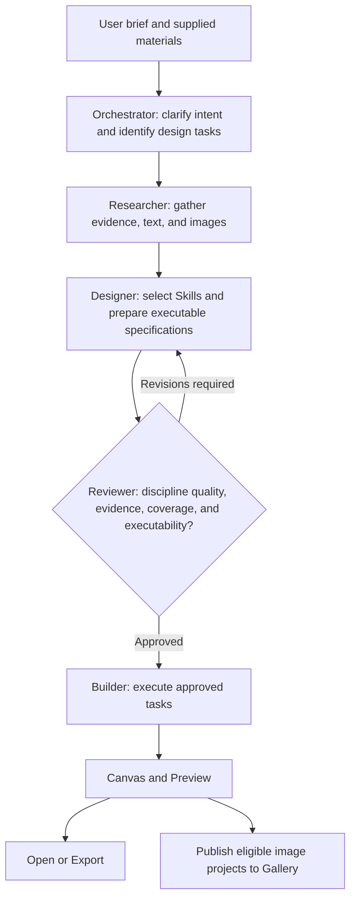

# DreamaticArt

**Turn a creative brief into reviewed design specifications, visual designs, and interactive interfaces.**

DreamaticArt is an open-source AI design system built on Pi. It coordinates specialist agents to clarify requirements, research materials, develop designs, review specifications, and produce deliverables. Projects retain their requirements, references, plans, reviews, and results in a local workspace.

Use DreamaticArt through the macOS or Windows desktop app, the Web interface, or the CLI.

**[Official website](https://www.dreamatic.art)** · **[Source code](https://github.com/idvxlab/Dreamatic)** · **[MIT license](LICENSE)**



> This README describes the **current source tree after the V2.1.0 release**. The root and desktop package versions remain **2.1.0**; subsequent development changes are included below without assigning a new release number. A downloaded installer may not contain these changes; check its build details.

## Contents

- [Who it is for](#who-it-is-for)
- [Core capabilities](#core-capabilities)
- [Design philosophy](#design-philosophy)
- [System architecture](#system-architecture)
- [Design workflow](#design-workflow)
- [Installation](#installation)
- [Using DreamaticArt](#using-dreamaticart)
- [Publishing to Gallery](#publishing-to-gallery)
- [CLI](#cli)
- [Development](#development)
- [Troubleshooting](#troubleshooting)
- [Documentation](#documentation)

## Who it is for

DreamaticArt helps designers, researchers, educators, and product teams turn an open-ended brief into a coherent set of design proposals and deliverables. Typical projects include brand identities, packaging concepts, exhibition graphics, research infographics, spatial or product concepts, and interactive web prototypes. A single brief can combine several design disciplines.

The system carries requirements and research through design, review, production, and delivery. Use the resulting work for exploration, communication, and prototype evaluation. A completed workflow does not establish manufacturing readiness, engineering certification, factual accuracy of every model-generated claim, or production application readiness; consequential content and final design quality still need human judgment.

## Core capabilities

### Design across disciplines

DreamaticArt supports brand and visual communication, industrial and product design, architecture and spatial design, media design, and UX/UI. A project can combine multiple disciplines.

| Task | Current deliverables |
| --- | --- |
| UX/UI | Designer-authored HTML/CSS/JavaScript pages, required states, and local user flows; an actual product page can serve as the project entry |
| Brand, product, industrial, architecture, and media design | Images, perspectives, details, or other supported visual expressions appropriate to the brief, presented through a Designer-authored HTML entry |
| Mixed projects | Each discipline's required outputs integrated through one shared presentation, with explicit access to all requested deliverables |

Professional **Skills** supply domain knowledge and reusable methods. Orchestrator assigns design scopes; Designer selects primary and supporting Skills for each scope and records the rationale. Supporting knowledge includes typography, accessibility, interface writing, motion, showcase storytelling, icon systems, and generative art. Loading a Skill does not add a new execution capability.

New projects have one required HTML presentation designed by Designer. Non-UX/UI showcases default to readable static HTML, local CSS, system fonts, visible images and captions, and native anchor navigation. Interactivity is added when it serves the brief or a concrete viewing task. UX/UI projects retain their requested states and flows. Historical Gallery presentations remain supported for viewing and delivery checks.

Non-UX/UI showcases include a visible **参考文献 / References** section. The default is IEEE numeric citation style, with explicit `[n]` labels and matching links from claims or captions; a user-requested academic style takes precedence. Sources come from adopted research, with available bibliographic metadata retained and missing information stated honestly.

Current visual outputs communicate design intent. CAD, engineering-grade 3D, video, and game-engine output are not implemented. HTML interfaces support local interactions; production backend integration is separate work.

### Research and material reuse

Provide URLs, images, or documents in the conversation. Researcher can search independently and extract useful text and images from supplied materials. Supported extraction includes webpages, text, and modern Office documents; scanned documents, PDFs, and older file formats have limitations that the system reports.

Designer selectively references researched material. When you explicitly request reuse of particular text or images, the workflow imports and incorporates those materials according to your instructions.

Research-discovered images are reference material by default. Explicitly supplied URLs and uploads can be imported with provenance for approved reuse. Search snippets, unavailable pages, and image metadata are distinguished from sources actually fetched or visually inspected. Full source text is cached locally while bounded excerpts enter model context.

### A persistent design workspace

- **Projects:** reopen, rename, revise, or move projects to recoverable local trash.
- **Live run status:** a fixed conversation panel shows the active Agent/action, elapsed time, latest status update, and stage milestones. Image batches report saved, failed, and pending items separately, with thumbnails appearing after successful saves.
- **Canvas:** inspect and arrange references, notes, and generated outputs.
- **Preview:** view image collections in a structured showcase or interact with the actual HTML delivery. Multi-page HTML projects retain a page selector.
- **Export:** download a ZIP containing outputs, sources, assets, design plans, and research while excluding sessions and system credentials.
- **Bilingual UI:** switch between English and Chinese. Dialogs follow the system language; project content is not automatically translated.
- **Model records:** final deliveries and previews identify reasoning and image models. Missing records in older projects can be supplemented at publication from current settings, with that provenance labeled.
- **Completion summary:** successful workflow export records delivered outputs, elapsed time including waits and retries, reported text-model tokens, image API call counts, and recorded follow-up directions. Image tokens are unmeasured rather than counted as zero.
- **Project switching:** conversation streams, running status, and asset updates stay associated with their project when switching between projects.

### Model configuration and recovery

The source Web/CLI configuration supports compatible Chat Completions and Responses endpoints, with optional models and thinking levels per agent. Image generation and editing use a separately configurable provider. Endpoint capabilities are declared explicitly; a model name alone does not establish support for a thinking switch, effort level, token budget, or strict tool schema.

Runtime diagnostics distinguish configured thinking levels, effective session levels, parameters actually sent, and reasoning observed in responses. A local `off` setting does not prove that a remote endpoint disabled reasoning. Pure reasoning exhaustion and ordinary output truncation receive different recovery handling: a specialist may attempt one recovery with a lower supported thinking control in that session, then stops if the same exhaustion recurs. Unknown controls or an already-off session stop with a diagnosis rather than repeating the same attempt. Durable tool results are retained and models are not automatically switched.

Network, image, and ordinary output retries remain bounded. Invalid tool parameters receive correction feedback; incomplete or truncated tool arguments are never executed as recovered content. These measures reduce avoidable repetition, but do not guarantee that every model obeys the endpoint controls or that every project completes without corrections.

### Share completed designs

Publish eligible image designs to the [official Gallery](https://www.dreamatic.art/gallery) directly from Preview. Publication includes creator attribution, upload progress, and confirmed replacement of an earlier version at the same URL.

**Pure HTML projects without delivered design images are temporarily ineligible for Publish. Mixed projects with delivered design images can be published.** HTML showcase pages for image collections remain eligible. Preview and Export remain available for HTML projects.

## Design philosophy

1. **Begin with intent.** Confirm the audience, design objective, maturity, constraints, and requested outputs before producing specifications. Categories describe professional responsibilities; an HTML presentation does not automatically make an industrial or spatial project a UX/UI project.
2. **Keep evidence and creativity connected.** Research supplies traceable facts and references. Designer uses that evidence to make design decisions, while distinguishing assumptions, hypotheses, and verified claims.
3. **Review by discipline.** UX/UI review examines pages, states, accessibility, responsive behavior, and flows. Other disciplines are reviewed for their actual form, structure, communication, materials, or use. Decorative complexity is not a requirement for a project showcase.
4. **Give each role clear ownership.** Designer authors the specification and page sources; Reviewer evaluates them; Builder executes the approved plan. Corrections return to the responsible role rather than becoming a second design process during production.
5. **Keep project memory durable.** Requirements, research, design, review, approval receipts, and outputs live in the local workspace. Working drafts, committed specifications, workflow completion, and public Gallery publication are separate states.
6. **Extend Pi rather than fork it.** Pi provides the model/session runtime and tool protocol. DreamaticArt adds design knowledge, project semantics, media adapters, review gates, and the product workspace.

## System architecture

The desktop app hosts the local service and Web interface. Web and CLI installations share the same design-agent package and workflow contracts.



| Layer | Responsibility |
| --- | --- |
| Web / desktop | Conversation, project navigation, live status, Canvas, settings, and Preview |
| Server | Session registry, HTTP/SSE transport, assets, project storage, isolated HTML preview, export, and Gallery upload |
| Design-agent package | Role boundaries, Context authoring, scoped Skills, workflow events, approval receipts, media execution, and delivery validation |
| Pi | Provider adapters, model conversations, tool execution protocol, resource loading, context compaction, and session persistence |
| Local workspace | Durable project records and generated results; generated Runs are not source code |

### Project memory and approval

New projects use four authoritative Context documents:

| Document | Owner | Contents |
| --- | --- | --- |
| `context/project.json` | Runtime | Brief, confirmed requirements, assigned scopes, and revision information |
| `context/research.json` | Researcher | Evidence, findings, source metadata, and usage conditions |
| `context/design.json` | Designer | Design system, strategy, deliverables, presentation, and nested execution specifications |
| `context/review.json` | Reviewer | Assessment, issues, resolved items, risks, and verdict |

Authors save small named updates into working drafts and commit them atomically. Runtime manages identities, versions, and hashes. Designer deliverables have stable IDs; each owns its scope, output path, production/presentation obligations, and `execution` parameters. Execution task views are derived from that specification rather than separately authored plans.

Reviewer approval binds the current specification and source files. Changed approved inputs require renewed approval. Required output production and user access are checked separately; a file existing on disk does not establish that users can reach it from the presentation. HTML validation uses declared viewports, local resource checks, and authored interaction checks where required. Final validation uses real assets and approved-source hashes. Mechanical checks do not certify visual fidelity or engineering feasibility.

Historical project formats are not silently migrated. They can remain readable and exportable when their delivery records are valid, but specialist dispatch on split-file projects requires explicit migration. A completed unified project can explicitly request a design-contract upgrade during revision; it then needs reconciliation, new review, and execution. See [Design Context](docs/DESIGN-CONTEXT.md) for the current contract.

## Design workflow

Orchestrator clarifies the brief and coordinates the agents. Reviewer approves the specification before Builder executes it. Required revisions return to Designer.



| Agent | Responsibility |
| --- | --- |
| **Orchestrator** | Understand goals, ask clarification questions, identify design types, and coordinate the workflow. It does not perform research, design, or audits directly. |
| **Researcher** | Gather evidence and references, extract supplied materials, preserve citation metadata, and record gaps and usage conditions. |
| **Designer** | Select scoped Skills, author executable design specifications, and create complete HTML presentation/product sources. |
| **Reviewer** | Judge the discipline's design, requirements, evidence, coverage, and executability; record a pass or actionable revisions. |
| **Builder** | Execute approved stored tasks, copy approved HTML sources/resources, and finalize delivery. It does not author pages, load Skills, or redesign outputs. |

Image tasks use approved prompts and parameters. HTML execution copies Designer's approved source bytes without another page-generation model call. Independent successful outputs can be reused during targeted recovery. `commit_design_context` saves canonical content; publishing a workflow result records stage completion; **Preview → Publish** uploads a completed project publicly. These are distinct operations.

## Installation

### macOS desktop app

For **Apple Silicon Macs (arm64)**:

1. Download the installer from the [official website](https://www.dreamatic.art/#download).
2. Open the DMG and drag the app into **Applications**.
3. Launch the app and open **DreamaticArt → Settings** to configure your model providers.
4. Click **New project** to begin.

The desktop app bundles its runtime; a separate Node.js installation is unnecessary. Model and search calls still require internet access, and model calls use your configured API keys.

Configuration and projects are stored in `~/Library/Application Support/Dreamatic/` and survive app upgrades. Source-based Web projects are not imported automatically.

Local installers use ad-hoc signing. If macOS blocks launch, verify the download source, then allow the app through **System Settings → Privacy & Security**.

<a id="web-and-cli-installation"></a>

### Web and CLI from source

#### Requirements

| Dependency | Requirement |
| --- | --- |
| Node.js | **22.19 or newer** |
| npm | **10 or newer** |
| Git | For cloning the repository |
| Reasoning provider | A vision-capable model with tool calling through a compatible Chat Completions or Responses protocol |
| Image provider | A compatible generation/editing service for image tasks |
| `zip` | Available on the server's `PATH` for Export and Publish |
| Chromium browser | An installed Chromium-based browser, such as Chrome, for required HTML presentation/interaction validation; source installs do not download one automatically |

#### Set up the project

```bash
git clone https://github.com/idvxlab/Dreamatic.git
cd Dreamatic
npm ci
cp .env.example .env
```

On Windows PowerShell, use `Copy-Item .env.example .env` and ensure a compatible `zip` executable is installed.

Edit `.env` with your provider settings:

```env
DREAMATIC_API_KEY=your-reasoning-api-key
DREAMATIC_BASE_URL=https://your-reasoning-provider/v1
DREAMATIC_MODEL=your-vision-capable-model

DREAMATIC_IMAGE_API_KEY=your-image-api-key
DREAMATIC_IMAGE_BASE_URL=https://your-image-provider/v1
DREAMATIC_IMAGE_MODEL=your-image-model
```

Chat Completions is the default reasoning protocol. Set `DREAMATIC_PROVIDER_TYPE=openai-responses` for providers implementing Responses. Standard image endpoint paths are inferred; custom generation and editing endpoints can be configured separately. An omitted image API key falls back to the reasoning key.

Research uses DuckDuckGo by default; Serper is optional. See [.env.example](.env.example) for Agent-specific models, concurrency, retries, timeouts, and browser settings. Keep API keys out of Git.

#### Configuration guide

| Setting | Purpose |
| --- | --- |
| `DREAMATIC_WORKSPACE` | Local project and session directory; source default is `./workspace` |
| `DREAMATIC_MODEL_<ROLE>` | Optional override for `ORCHESTRATOR`, `RESEARCHER`, `DESIGNER`, `REVIEWER`, or `BUILDER`; blank uses the default model |
| `DREAMATIC_THINKING_LEVEL_<ROLE>` | Role thinking preference, subject to the model's supported levels and endpoint controls |
| `DREAMATIC_MODEL_CAPABILITIES` | JSON declarations keyed by exact model ID for the active endpoint, using supported Pi compatibility fields |
| `DREAMATIC_SEARCH_PROVIDER` / `DREAMATIC_SEARCH_API_KEY` | Optional `serper` search instead of the default DuckDuckGo provider |
| `DREAMATIC_IMAGE_GENERATION_ENDPOINT` / `DREAMATIC_IMAGE_EDIT_ENDPOINT` | Overrides for image services with nonstandard endpoint paths |
| `DREAMATIC_HTML_BROWSER_EXECUTABLE` | Explicit path to an installed Chromium browser when automatic discovery fails |
| `DREAMATIC_SITE_URL` | Compatible Gallery publication destination |

Model capabilities must match the actual gateway/provider. Supported declarations include thinking format, level mappings, optional thinking budget fields, output/context limits, and strict tool support. An unsupported level can be declared with a null mapping. Do not copy another model's configuration just because its name or API shape looks similar. See [Performance and diagnostics](docs/PERFORMANCE.md#model-response-diagnosis-and-recovery) for examples and supported fields.

Model response limits cover different phases: `DREAMATIC_MODEL_TURN_TIMEOUT_MS` bounds waiting for first output, `DREAMATIC_MODEL_GENERATION_TIMEOUT_MS` bounds generation after output starts, and `DREAMATIC_MODEL_IDLE_TIMEOUT_MS` bounds a stalled stream. `DREAMATIC_MODEL_TOTAL_TIMEOUT_MS` optionally caps the whole response. Image requests have separate overall and body-idle timeouts. Increase a limit only after inspecting the relevant phase; larger allowances can also increase latency and consumption.

New projects require browser validation for required presentation access. Setting `DREAMATIC_HTML_BROWSER=off` does not make those checks pass; static-only operation is limited to contracts that do not require browser evidence. Installing Chrome or configuring its executable is the practical default for source use.

#### Start the Web interface

For development:

```bash
npm run dev
```

Open the URL printed in the terminal, normally **http://localhost:5173**. The API defaults to **http://localhost:4310**. Keep the process running.

The development launcher currently waits for the API at port **4310**. Keep that port for `npm run dev`; custom server ports can be used with the built application. The launcher builds the backend before starting; it does not hot-reload backend source changes.

For the built application:

```bash
npm run build
npm start
```

Open **http://localhost:4310**.

Web and CLI use the repository's `workspace/` by default. Relative `DREAMATIC_WORKSPACE` paths resolve from the repository root. These instructions describe local use; HTML previews run on a separate local service origin.

## Using DreamaticArt

### 1. Configure providers and create a project

Open **DreamaticArt → Settings**. Configuration is grouped into search, reasoning models, image models, and system parameters. **Assets** opens the current project folder in the system file manager, showing original generated files and research materials. This requires the desktop app or a locally hosted web app. The toolbar shows the current project’s publication status; Preview, Share and Publish use the same live status.

Optional reasoning settings, including Agent-specific models and thinking levels, are available under **Advanced**. Agent-specific models override the default model when configured. Image endpoint overrides and response format, plus system ports, retries, concurrency, timeouts and validation controls, are also available under **Advanced**.

Only modified fields are saved. Leaving a key input blank preserves the existing secret. Saved configuration applies automatically to existing conversations and subsequent tasks. The app reloads when the workspace changes; the browser reconnects when the server port changes. The macOS app manages its own local port. Wait for an active task or publication to finish before saving.

If you edit `.env` externally while the app is running, Settings reports changes waiting to be applied. Save Settings to validate and apply the persisted configuration, or restart the service. Reading Settings alone does not activate external file changes.

**An empty workspace does not automatically create a project.** Conversation input, attachments, and sending remain disabled until you click **New project**. Deleting the last project disables them again.

### 2. Describe the brief and material requirements

Specify the audience, purpose, style, deliverables, and content that must be retained. For example:

> Design packaging and a visual identity for a contemporary tea brand aimed at young adults. Use a restrained Eastern visual language and deliver a packaging hero view, a usage scene, and a collection overview.

> Extract and reuse the research description, publication text, and portrait photographs from my supplied website URL. Design a responsive academic homepage with English/Chinese switching, publication filtering, and mobile navigation.

Attach relevant images or documents. State explicitly which materials should be referenced, extracted, or reused unchanged. Answer clarification questions so the agents can proceed with an aligned brief.

For better results, include:

- **Use and audience:** who will use the design and where it will appear.
- **Deliverables and detail:** number of views/pages, required content, preferred dimensions, and whether the result is a concept or an interactive prototype.
- **Constraints:** text, logos, identities, materials, and interactions that must be preserved; distinguish mandatory requirements from preferences.
- **Evidence:** sources to use, the time period of factual data, citation style, and how uncertainty should be represented.
- **Acceptance:** the specific questions each output should answer or the actions a user must be able to complete.

The Web attachment picker accepts up to four files per message: 12 MB per image, 128 MB per other file, and 160 MB total. Documents and videos are stored as files; uploading them does not establish that the model can directly interpret every format. Extraction limitations are reported by the workflow.

### 3. Inspect and preview the result

Follow progress in the conversation and inspect project materials on Canvas. After completion, open **Preview**.

| Action | Behavior |
| --- | --- |
| **Open** | Open the delivered presentation separately; the desktop app uses a preview window |
| **Export** | Save the complete project ZIP; the desktop app uses a native save dialog |
| **Publish** | Upload eligible image or mixed projects to the official Gallery |
| **Share** | After successful publication, copy the official project link and open it in a new browser window or tab; the confirmation fades after four seconds |

Extract an exported ZIP before opening its `index.html` launcher. Continue in the same project to request revisions; revised specifications are designed and reviewed before execution.

### 4. Revise, recover, and retain your work

Request changes in the same project and identify the affected outputs or requirements. Valid research and successful outputs can be retained, while changed design specifications require a new approval before execution. Stopping a task interrupts execution; it does not mean previously saved work is deleted. Resume through the project conversation or the CLI's recorded session.

A working update can return `saved:true` with `readiness:incomplete` while the agent is still filling other sections. This is a draft progress report, not a failed save or review verdict. An `isError:true` result or `saved:false` means that call was rejected; inspect its field-specific feedback and subsequent recovery. Stage completion requires a committed workflow event, not merely a successful Context update.

Back up the entire workspace if you need to preserve projects, sessions, provenance, and local publication-update credentials. Exported ZIPs are portable deliverables, not full runtime backups. Desktop data is under `~/Library/Application Support/Dreamatic/`; source installations use the configured workspace and `.env`.

Briefs and selected material content are sent to your configured model/search/media services as needed. Project files are stored locally; explicit Gallery publication shares the packaged outputs and included references publicly. Check the content and material permissions before confirming publication.

## Publishing to Gallery

1. Open **Preview → Publish** in a completed image project.
2. Verify the destination and enter optional creator information.
3. Confirm that the contents may be shared publicly. If an existing publication is detected, confirm replacement.
4. Wait for packaging, upload, and deployment, then open the returned project link.

The default destination is [https://www.dreamatic.art](https://www.dreamatic.art). Change `DREAMATIC_SITE_URL` in system settings to use another compatible site.

Creator name, organization, and website are self-declared; they do not activate authentication or represent a verified account. An empty name displays **Anonymous**.

The publication ZIP limit is **128 MiB**. It includes outputs, sources, and references, while excluding sessions, private runtime records, and hidden metadata files. Progress and waiting states prevent duplicate submission during publication.

The system generates a stable publication identifier and stores a private update credential locally. Confirmed republication replaces the earlier contents at the same URL. Older publications without a saved update credential cannot be automatically claimed for replacement.

Existing model records are retained. Missing reasoning or generation groups are supplemented from current settings in the publication package, labeled `publication_config_fallback`, and identified as supplemented in the online preview. This does not recover the historical models actually used.

The website's homepage shows recent projects; its dedicated Gallery supports categories, search, and pagination, with creator, date, and model information on project cards.

### Manual installation of projects on DreamaticSite

Website administrators can copy a project folder into `gallery/<project-name>/`. The scanner supports both `final/artifacts/` and `artifacts/`; refreshing the page discovers the project without rebuilding the frontend.

This manual administrative path also supports HTML projects. The temporary HTML restriction applies to the Publish upload flow. See the DreamaticSite project documentation for deployment and directory configuration.

## CLI

Build before first use:

```bash
npm run build
```

```bash
# Start a design task
npm run cli -- "Design a visual identity and poster system for a technology exhibition"

# Design an HTML interface
npm run cli -- "Design a responsive academic homepage with publication filtering"

# Attach a reference image
npm run cli -- --image ./reference.png "Preserve the logo and design a poster series"

# Start an interactive session
npm run cli

# Emit machine-readable events
npm run cli -- --json "Design a product concept"

# Resume after the original process has stopped
npm run cli -- --resume <run-id>

# Show all options
npm run cli -- --help
```

CLI tasks start directly from the terminal; the Web interface's empty-project input restriction does not apply to CLI task creation.

## Development

DreamaticArt extends Pi through its SDK, Extensions, Skills, and session APIs. Pi remains an upstream dependency.

| Directory | Purpose |
| --- | --- |
| `apps/web` | React interface, Canvas, and Preview |
| `apps/server` | HTTP/SSE, sessions, assets, and application policy |
| `apps/cli` | Command-line entry point |
| `apps/desktop` | macOS and Windows desktop application |
| `packages/design-agent` | Design tools, workflows, and delivery contracts |
| `.pi/agents` | Agent instructions |
| `.pi/skills` | Professional and supporting Skills |
| `workspace` | Local project and session output; generated runs are not committed |

### Check and build

```bash
npm run check
npm run build
```

After updating source, install locked dependencies, rebuild, restart the service, and refresh the browser. Building alone does not update a running backend.

### Build a macOS installer

On an Apple Silicon Mac:

```bash
npm run release:mac
```

The script works on the current branch. Version selection uses `--version X.Y.Z` first, then a version-named branch such as `v2.1.0`, then `package.json`. The script builds, checks, runs regression and desktop validation, and produces `release/DreamaticArt-<version>-mac-arm64.dmg` with a SHA256 file.

To set an explicit version or reuse installed dependencies:

```bash
npm run release:mac -- --version 2.1.0
npm run release:mac -- --skip-install
```

Release logs are saved under `release/logs/`. The previous DMG is replaced only after verification succeeds. Signing is ad-hoc; Developer ID signing and notarization require separate Apple credentials.

Use `npm run desktop` for macOS desktop development.

### Build a Windows installer

On a 64-bit Windows 10 or 11 computer with Node.js 22.19 or newer, open PowerShell in the repository and run:

```powershell
npm run release:win
```

Windows builds are native: macOS builds the macOS DMG, while Windows builds and runs the Windows x64 application before producing `release/DreamaticArt-<version>-windows-x64-setup.exe` and its SHA256 file. The release checks types, regression tests, the bundled Node/Pi/browser runtime, desktop Settings/Preview/Export, the packaged application, and the NSIS installer.

The Windows command supports the same release options:

```powershell
npm run release:win -- --version 2.1.0
npm run release:win -- --skip-install
```

Use `npm run desktop:win` for Windows desktop development and `npm run desktop:package:win` for a faster package-only development build. The final release gate is one manual install and uninstall on Windows. If electron-builder signing credentials such as `WIN_CSC_LINK` and `WIN_CSC_KEY_PASSWORD` are supplied through secure local or CI environment variables, the executable and installer are signed automatically; never commit certificate files or passwords.

## Troubleshooting

| Issue | What to check |
| --- | --- |
| Model calls fail | API key, base URL, model ID, and protocol; image services must support the requested generation/editing operation |
| Thinking is configured off but reasoning tokens appear | Inspect actual request controls and response observations; declare only verified endpoint capabilities |
| Long model responses stop at the token limit | Distinguish pure reasoning exhaustion from output truncation; check supported lower controls, output limits, and response-phase diagnostics |
| `research_fetch_batch` rejects arguments | Supply a nonempty `sources:[{url:...}]` array alongside `runId`; reuse existing search results rather than repeating the search |
| Context update is rejected | Follow the named-field nesting and stable IDs. Research metadata belongs inside `evidence`; each Designer output belongs in `deliverables[]` with its `id`. A rejected update saves none of that call's changes |
| Context is saved but reports incomplete | The working draft is retained; remaining required sections must be filled before commit and stage publication |
| HTML publication or finalization is blocked | Check installed Chromium, local source/resource mappings, interaction checks, and access to every required output; browser evidence cannot be replaced with a review score |
| An old project cannot dispatch specialists | Its original data is preserved; split-file projects need explicit Context migration, and contract upgrades require renewed review |
| Conversation input is disabled | Create or select a project first |
| An update has no effect | Rebuild, restart, and refresh; desktop changes require an updated application build |
| Publication fails | ZIP size, matching website API version, and Gallery storage permissions; concurrent uploads may wait in the queue |
| Unexpected hourly publication limit | The website's per-IP hourly cap is configurable and defaults to disabled; check its deployed configuration |
| A manually deleted work still has a local record | Publish checks the public Gallery; an unavailable website retains a conservative uncertainty warning |
| Older projects lack model records | Publish supplements missing groups from publication-time settings and labels their provenance |

For timing and consumption diagnosis, inspect the Run's `.performance/model-requests.jsonl` and `bus.jsonl`. The former records request controls, phase timings, usage, and aggregate reasoning/output evidence without storing prompt or reasoning text in those diagnostics. Session history is separate. After workflow export, `completion-summary.json` records the completion summary; missing usage remains explicitly unmeasured.

```bash
npm run diagnose:performance -- /absolute/path/to/workspace
```

This command analyzes local historical records without invoking a design agent. Provider prices, image token consumption, and creative quality cannot be inferred from timing alone.

## Documentation

| Document | Use |
| --- | --- |
| [Architecture](docs/ARCHITECTURE.md) | Pi integration, ownership, and runtime boundaries |
| [Design Context](docs/DESIGN-CONTEXT.md) | Current storage, authoring, scope/Skill binding, approval, and delivery contracts |
| [Performance and diagnostics](docs/PERFORMANCE.md) | Request telemetry, endpoint capabilities, timeouts, and bounded recovery |
| [Skill sources](docs/DESIGN-SKILL-SOURCES.md) | Supporting Skill additions and their design-method provenance |
| [Migration notes](docs/MIGRATION.md) | Historical compatibility and explicit contract upgrades |
| [V2.0.3 background](docs/V2.0.3.md) | Versioned introduction of scoped Skills and HTML execution; historical details defer to the current Context contract |

Since the V2.1.0 release tag, the source has added unified Context authoring, stronger role boundaries, Designer-owned project HTML, source/access validation, scoped multi-binding Skill reuse, additional supporting Skills, citation requirements, completion summaries, project-switch isolation, and more precise model diagnostics and recovery. The sections above describe the complete current system rather than only these changes. Downloaded builds and existing project contracts may differ from the current source tree.

## License

[MIT](LICENSE)
